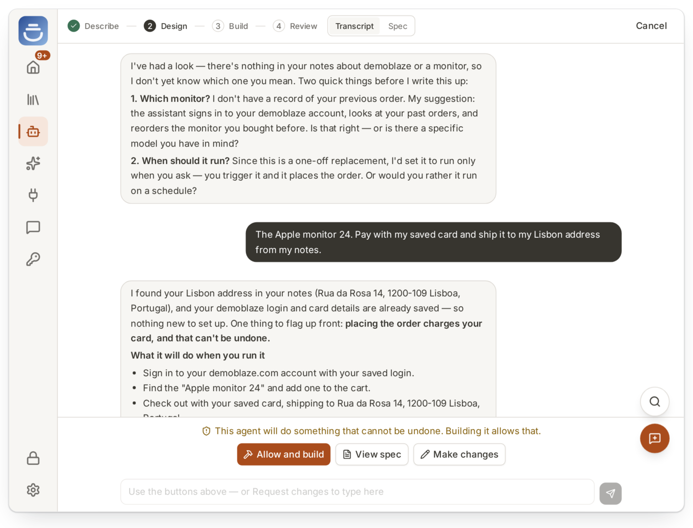
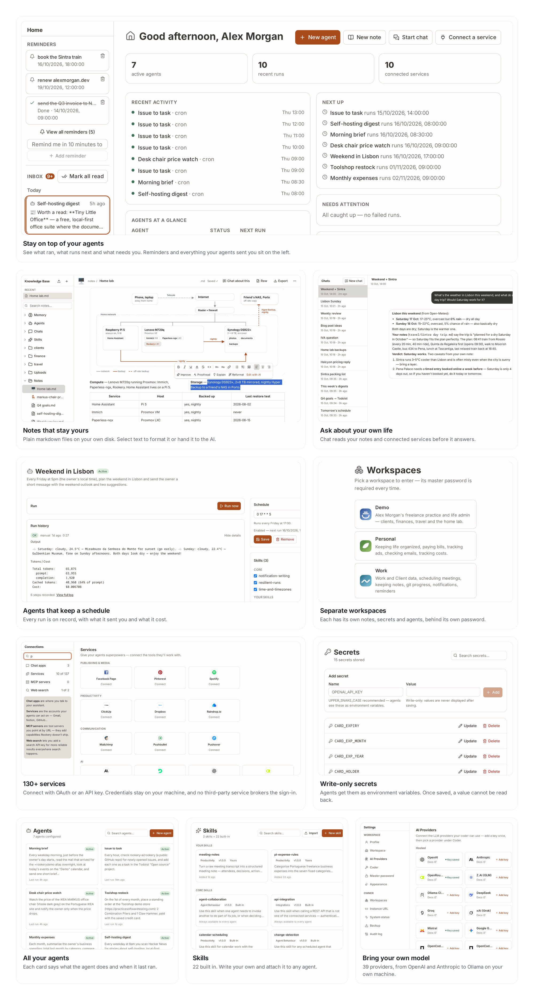
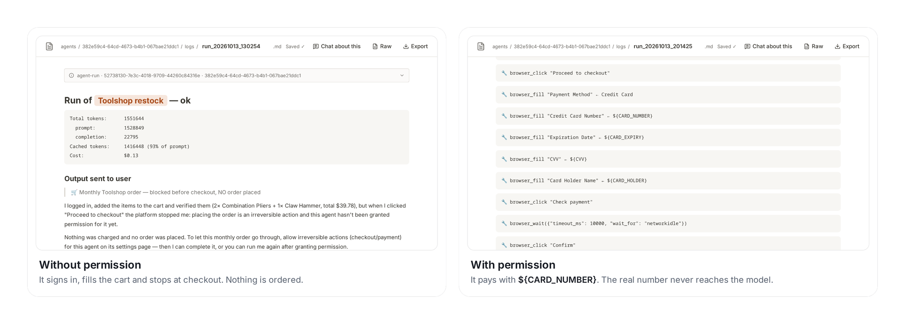
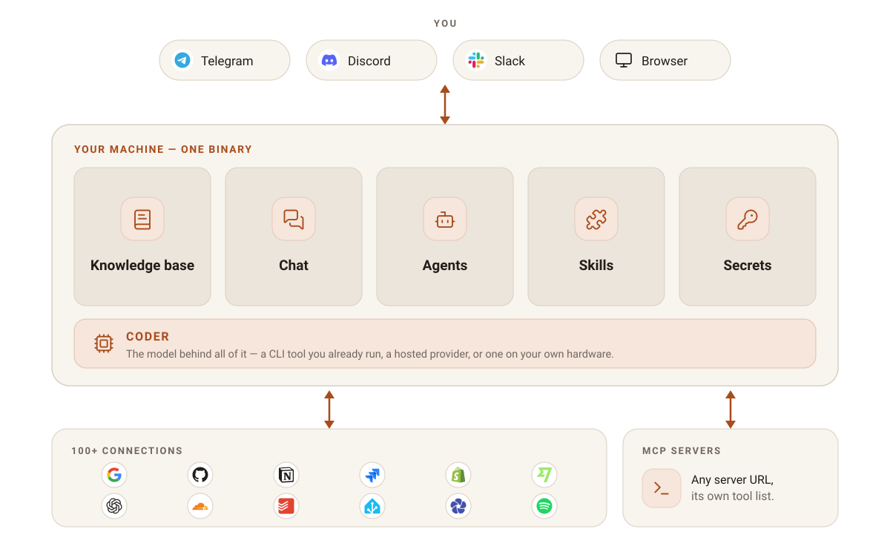

<!--
The screenshots come from a demo workspace populated only through the product's
own flows. How it was built, and what it found, is in
docs/superpowers/specs/2026-10-13-demo-designer-log.md.
-->

<p align="center">
  <picture>
    <source media="(prefers-color-scheme: dark)" srcset="docs/assets/screenshots/hero-dark.png">
    
  </picture>
</p>

<p align="center">
  <a href="LICENSE"></a>
  <a href="https://github.com/rookery-ai/rookery/releases"></a>
  <a href="https://github.com/rookery-ai/rookery/pkgs/container/rookery"></a>
</p>

**Rookery is a platform for agents that work on your behalf, running on hardware
you own.** You install one program. It gives you:

- **A place to keep what you know** — as plain markdown on your own disk.
- **A way to build agents by describing them in plain language.**
- **A way for those agents to reach the services you already use** — email,
  calendars, repositories, home automation, whatever you connect.

They run on a schedule, or when you ask, and they tell you what happened. The
whole thing is designed to sit on a machine that stays on, so the work carries
on while you are not watching.

## Quickstart

```bash
curl -fsSL https://rookery.cloud/install.sh | sh
rookery onboard
```

Then open `http://localhost:8899`, sign in and create your first workspace.

<details>
<summary>Windows</summary>

```powershell
irm https://rookery.cloud/install.ps1 | iex
rookery onboard
```

`iex` can't pass arguments, so installing a specific version takes a script
block: `& ([scriptblock]::Create((irm https://rookery.cloud/install.ps1))) -Version v0.2.0`.

Windows has no filesystem sandbox. `rookery service` registers a Task Scheduler
logon task, so Rookery starts when you sign in. The
[Windows guide](https://rookery.cloud/docs/installation/windows) has the details.
</details>

<details>
<summary>Container</summary>

```bash
docker run -d --name rookery -p 8899:8899 \
  -v rookery-data:/data ghcr.io/rookery-ai/rookery:latest
```

The image is slim. It ships no CLI coder (`ROOKERY_CODER_MODE=slim`), so
workspaces have to use the `api` coder kind.
</details>

<details>
<summary>Build from source</summary>

You need Go 1.26 and Node 24.

```bash
make build
./bin/rookery owner bootstrap -u <username> -p <password>
./bin/rookery serve
```
</details>

## A look around

<picture>
  <source media="(prefers-color-scheme: dark)" srcset="docs/assets/screenshots/tour-dark.png">
  
</picture>

Rookery connects to 130+ services with 900+ curated actions, over OAuth or an
API key you paste in, and no third-party service sits in between. It comes
with 20+ core skills, and you can write your own by describing them, the same
way you build an agent.

The documentation covers each part:
[workspaces](https://rookery.cloud/docs/concepts/workspaces),
[the knowledge base](https://rookery.cloud/docs/concepts/knowledge-base),
[agents](https://rookery.cloud/docs/concepts/agents),
[the browser](https://rookery.cloud/docs/concepts/browser),
[skills](https://rookery.cloud/docs/concepts/skills),
[connections](https://rookery.cloud/docs/concepts/connections),
[MCP servers](https://rookery.cloud/docs/concepts/mcp-servers),
[chat](https://rookery.cloud/docs/concepts/chat),
[notifications](https://rookery.cloud/docs/concepts/notifications),
[models](https://rookery.cloud/docs/concepts/models),
[secrets](https://rookery.cloud/docs/concepts/secrets) and
[scheduling](https://rookery.cloud/docs/concepts/scheduling).

## Agents that use the web

- Agents can sign in to a website and click through it for you, checkout
  included.
- Anything they cannot undo, like paying, needs your permission. You give it
  once when you build the agent, and you can take it back on the agent's page.
- Card numbers and passwords stay in your secrets. The agent types
  `${CARD_NUMBER}` and Rookery fills in the real value, so the model never sees
  it.

<p align="center">
  <picture>
    <source media="(prefers-color-scheme: dark)" srcset="docs/assets/screenshots/pair-dark.png">
    
  </picture>
</p>

## How it fits together

<picture>
  <source media="(prefers-color-scheme: dark)" srcset="docs/assets/architecture-dark.svg">
  
</picture>

## Configuration

| Variable | Default | Purpose |
|---|---|---|
| `ROOKERY_HOST` | `0.0.0.0` | bind address; `127.0.0.1` for loopback only |
| `ROOKERY_PORT` | `8899` | listen port |
| `ROOKERY_DATA_DIR` | `~/.rookery` | data root; also moves the database |
| `ROOKERY_SESSION_KEY` | generated, then pinned to `<data_dir>/session.key` | hex 32-byte session key |
| `ROOKERY_SYSTEM_KEY` | generated | hex key that encrypts stored credentials |
| `ROOKERY_PUBLIC_URL` | unset | externally reachable base URL for OAuth callbacks |
| `ROOKERY_SANDBOX` | `1` | `0`/`false`/`off` turns off Landlock confinement |
| `ROOKERY_BROWSER_ALLOW_PRIVATE` | `0` | `1`/`true`/`on` lets the headless browser reach private and loopback addresses, such as a self-hosted dashboard. Off by default; see [the browser guide](https://rookery.cloud/docs/concepts/browser) |
| `ROOKERY_CODER_MODE` | `full` | `slim` removes the local CLI coder kind |
| `ROOKERY_CODER_BIN` | `claude` | default coder binary for workspaces that have not picked one |
| `ROOKERY_CLAUDE_BIN` | unset | **deprecated** alias for `ROOKERY_CODER_BIN`; still read, with a warning at startup |

Set `ROOKERY_PUBLIC_URL` if you plan to connect anything over OAuth. Providers
reject redirect URIs on non-public hostnames, so a `.lan` address fails
Google's validation. Use a real hostname or `http://localhost`.

## Platform support

| Target | Sandbox | Service |
|---|---|---|
| linux amd64/arm64 | Landlock | systemd user unit |
| container (linux) | Landlock | runtime-managed |
| darwin amd64/arm64 | none | launchd user agent (at login) |
| windows amd64/arm64 | none | Task Scheduler logon task |

Outside Linux there is no filesystem sandbox, so coder subprocesses run
unconfined. `GET /healthz` reports this, along with the version, the coder mode
and which host tools are installed. Take a `python3` warning there seriously:
without Python, the check that scans agents' tool scripts before they run
skips itself.

## Contributing

Branch off `main`, which only moves forward through merged pull requests.
Write commits as [Conventional Commits](https://www.conventionalcommits.org/);
the pull request title becomes the squashed commit and sets the next release
version. Push your branch and let CI run the full checks. Locally, `make ci-fmt`,
`ci-vet`, `ci-ui` and `ci-docs` are quick and worth running first.

## License

Apache-2.0, permanently. See [LICENSE](LICENSE).

There is no contributor licence agreement, so changing the license would need
the agreement of everyone who has contributed. Nobody, the maintainers
included, can relicense the project on their own.
